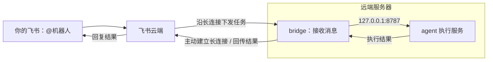

# 飞书 ↔ 远端 agent 桥接

本节目的：说明消息如何到达服务器，以及该从哪份教程开始部署。

在飞书里 `@机器人 + 任务描述`，服务器收到消息后调用 agent，执行结果再回复到飞书。你的电脑和服务器可以位于不同网络。

**推荐把 `bridge` 和 `remote_agent_server.py` 都部署在服务器上。服务器主动连接飞书，飞书通过已建立的长连接下发消息；你的电脑只需要使用飞书。**

## 当前终端会话模式（`/lark agent on`）

如果希望飞书任务进入已经打开的 Claude Code 对话，而不是另起 agent，使用 [当前会话部署说明](deploy/current-session.md)。这个模式通过 SQLite 队列和后台任务通知续接当前对话，不依赖 Channels，也不会运行并发 `--resume`。需要保持终端开启，并安装仓库提供的 [lark skill 模板](skills/lark/SKILL.md)。

现有 HTTP/SSH/本地命令模式仍按下面的教程使用；两种模式不要同时处理同一机器人的任务。

## 一、选择部署教程

本节目的：区分本机验证与服务器常驻运行，避免把任务发到错误的机器。

| 场景 | 在哪里运行代码 | 教程 |
|---|---|---|
| 先验证解析、转发和回传 | 本机，使用模拟消息与模拟 agent | [本机部署与联调](deploy/local.md) |
| 临时验证真实飞书机器人 | 本机，任务也在本机执行 | [本机连接真实飞书](deploy/local.md#四可选连接真实飞书) |
| 通过飞书控制不同网络的服务器 | 两个服务都在服务器，本机只使用飞书 | [服务端部署](deploy/server.md) |

跨网络部署不需要本机 SSH 到服务器，也不需要开放服务器的入站端口。服务器需要能主动访问飞书 API、飞书长连接服务，以及 agent 使用的模型服务。首次安装可以通过服务器网页终端、云平台控制台或平台提供的文件上传功能完成。

## 二、机器人与飞书配置

本节目的：让接收消息和发送结果使用同一个应用机器人。

已有“**wusi的飞书 CLI**”时，复用该应用即可，App ID 为 `cli_aa9c105a7678dbdb`。App Secret 在飞书开放平台的“凭证与基础信息”中获取，填入部署机器的 `.env`。

本项目通过 `lark-oapi` SDK 连接飞书，读取 `FEISHU_APP_ID` / `FEISHU_APP_SECRET`。飞书 CLI 的 `profile use wusi`、用户登录态和本项目的运行配置相互独立；机器人运行使用应用凭证，不要求用户 OAuth 登录。

在该应用的飞书开放平台后台确认：

1. 已启用机器人能力。
2. 已开通以应用身份发送消息 `im:message:send_as_bot`、接收单聊消息 `im:message.p2p_msg:readonly`、接收群聊中 @ 机器人的消息 `im:message.group_at_msg:readonly`。
3. “事件与回调”的订阅方式为“使用长连接接收事件”，添加 `im.message.receive_v1`。
4. 应用版本已发布，新增权限和事件已生效；使用者在应用可用范围内。
5. 已把“wusi的飞书 CLI”拉入目标群，或打开与机器人的单聊。

SDK 启动成功后，前台日志应出现长连接相关日志。只看到“长连接启动中”这一行还不能证明连接已建立，继续观察 SDK 的连接结果。

`ALLOW_OPEN_IDS` 使用这个应用下的用户 `open_id`。不同应用下的 `open_id` 可能不同，不要直接复制其他应用的用户 ID。首次可留空启动，再 @ 一次机器人；从“未授权用户 open_id=...”日志或拒绝回复中取得 ID，填入 `.env` 后重启。

## 三、关键配置

本节目的：说明两项服务之间的接口，以及配置由谁读取。

| 配置 | 用途 |
|---|---|
| `FEISHU_APP_ID` / `FEISHU_APP_SECRET` | `bridge` 连接飞书的应用凭证 |
| `BOT_OPEN_ID` | 可选；未填写时 `bridge` 调用接口获取机器人自身 ID |
| `ALLOW_OPEN_IDS` | 可执行任务的用户，逗号分隔；留空拒绝所有人 |
| `ALLOW_CHAT_IDS` | 可选的群/会话白名单；留空不限制 |
| `AGENT_TRANSPORT=http` | 教程推荐的执行后端 |
| `AGENT_URL=http://127.0.0.1:8787/task` | 同一台机器上的 agent 执行服务 |
| `AGENT_TOKEN` | 两项服务共用的接口令牌 |
| `CLAUDE_COMMAND` / `CLAUDE_WORKDIR` | agent 服务的命令与任务工作目录 |
| `AGENT_TIMEOUT` | `bridge` 等待 agent 的超时；默认 900 秒 |
| `WORKERS` | 不同会话的任务线程数 |
| `STATE_DIR` | `bridge` 的会话映射保存目录 |

`bridge` 自动读取 `.env`；`remote_agent_server.py` 读取进程环境变量，**不会自动读取 `.env`**。教程中的前台启动会先加载 `.env`，systemd 模板则使用 `EnvironmentFile` 加载同一份文件。

## 四、在飞书中使用

本节目的：说明部署完成后如何触发任务并查看状态。

| 消息 | 效果 |
|---|---|
| `@机器人 /ping` | 确认消息已到达桥接进程 |
| `@机器人 /status` | 查看后端、会话 ID 与运行状态 |
| `@机器人 请只输出当前工作目录` | 验证 agent 确实运行在指定机器与目录 |
| `@机器人 /new` | 清除后续任务使用的会话上下文；不停止正在执行的任务 |
| `@机器人 /help` | 查看指令说明 |

单聊直接发送任务即可。群聊必须 @ 目标机器人。`/ping` 只检查桥接进程，不能证明模型和 agent 执行正常；再发送一个简单任务验证完整链路。

## 五、现有行为与边界

本节目的：说明当前代码实际支持的行为，避免把教程当成尚未实现的保证。

- 文本与富文本任务经过白名单检查后交给后台线程执行，结果自动分片回传。
- HTTP 示例针对 Claude Code：命令从 stdin 接收任务，JSON 输出中的 `session_id` 用于下一次 `--resume`。
- SSH/本地命令后端可执行单次任务，但当前没有将已有会话 ID 加入执行命令；教程使用 HTTP 后端完成续会话。
- 去重记录位于内存，默认保留 900 秒；进程重启后不保留。会话映射保存到 `STATE_DIR/sessions.json`。
- 消息回调目前会同步发送“收到”等回复，慢网络会延长回调时间；不保证固定时间内 ACK。
- 同会话忙碌检查与占用不是原子操作，并发调用时可能同时提交任务。现阶段每个机器人只运行一个桥接实例，任务按次发送并等待完成。
- Claude Code 的实际工具权限、登录或模型网关配置需要在服务运行用户下完成。非交互模式无法现场回答权限确认，先按任务范围配置并验证权限。

## 六、文件说明

本节目的：定位教程、配置模板和消息执行链路的源码。

| 文件 | 作用 |
|---|---|
| [deploy/local.md](deploy/local.md) | 本机环境准备、离线联调与真实机器人验证 |
| [deploy/server.md](deploy/server.md) | 不同网络的服务器部署、systemd 自启、排错与更新 |
| [.env.example](.env.example) | 应用、白名单与 agent 配置示例 |
| `bridge/app.py` | SDK 长连接入口与模拟消息入口 |
| `bridge/dispatch.py` | 鉴权、去重、指令处理与任务分发 |
| `bridge/feishu.py` | 飞书消息回复与分片发送 |
| `bridge/agent.py` | HTTP/SSH/本地命令调用与会话保存 |
| `remote_agent_server.py` | 将 agent CLI 包装成 HTTP 接口 |
| `deploy/*.service` | 读取 `.env`、使用虚拟环境的 systemd 模板 |
| `tests/test_core.py` | 23 个离线单元测试 |
